# All-in-1 Installer

A C# desktop installer that sets up a **full hotel server** on an **Ubuntu Server or Debian**
machine over SSH:

| Component | Repository |
|-----------|------------|
| Polaris Emulator (Java 25 game server + MariaDB) | <https://github.com/duckietm/Polaris-Emulator> |
| Octane (browser client) | <https://github.com/duckietm/Octane> |
| Octane Renderer | <https://github.com/duckietm/Octane-Renderer> |

The GUI uses the same Avalonia "Professional" look as the
[All-in-1 Converter](https://github.com/duckietm/all-in-1-converter): dark sidebar, cards,
status pill and console log, in light and dark mode.

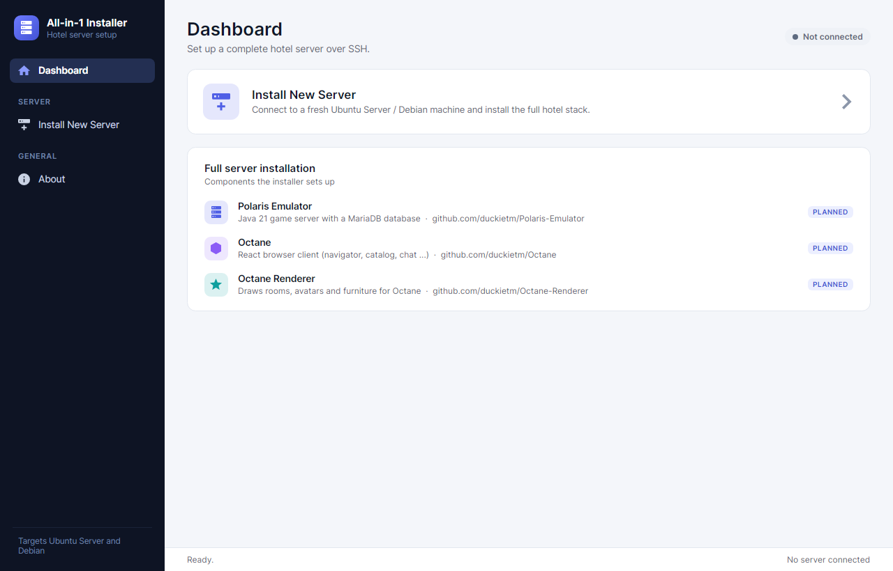

## Requirements

**On your computer** (Windows 10/11 x64 or Linux x64), the installer needs **.NET 11**:

| How you run it | What to install |
|---|---|
| Published single file (`publish-win.bat` / `publish-linux.sh`) | Nothing: .NET is included in the file |
| A normal build (`bin/Debug/net11.0` or `bin/Release/net11.0`) | **.NET 11 Runtime** (the plain .NET Runtime; the Desktop and ASP.NET Core runtimes are not needed) |
| Building from source | **.NET 11 SDK** (includes the runtime) |

Download: **<https://dotnet.microsoft.com/download/dotnet/11.0>**. .NET 11 is at release candidate 2
(`11.0.100-rc.2`, supported for production use); the final release follows in November 2026. Any 11.0 SDK from
`11.0.100-rc.1` up works (`global.json` rolls forward). Check what is installed with `dotnet --list-sdks` and
`dotnet --list-runtimes`.

On Linux without a package, Microsoft's install script works too:

```bash
curl -fsSL https://dot.net/v1/dotnet-install.sh -o dotnet-install.sh
bash dotnet-install.sh --channel 11.0 --quality preview      # the SDK, into ~/.dotnet
export PATH="$HOME/.dotnet:$PATH"
```

**The server**: a fresh Ubuntu Server (22.04 or newer) or Debian (12 or newer) machine you can reach over SSH as
root or as a user with sudo rights. Everything else (NGINX, PHP, MariaDB, Java, Node.js, Docker ...) is installed
by the wizard.

## Status

**Step 1 – Install New Server: login and root access** (done)

From the dashboard or the sidebar, click **Install New Server**. The installer then asks:

1. **Server IP / Hostname**: e.g. `192.168.1.10` or `hotel.example.com`. Add `:2222` for a
   different SSH port (`[::1]:2222` for IPv6).
2. **User account**: `root`, or a user with sudo rights.
3. **Password**

Then it:

- logs in over SSH (password or keyboard-interactive / PAM),
- reads `/etc/os-release` and refuses anything that is not Ubuntu or Debian,
- switches to root when the user is not root:
  - passwordless sudo (`NOPASSWD`) is detected and used,
  - otherwise the password is sent to `sudo -S` over **stdin**, so it never shows up in `ps`,
  - a user that is not in the `sudo` group gets a clear error with the fix
    (`usermod -aG sudo <user>`),
- confirms root access by running `id -un` as root.

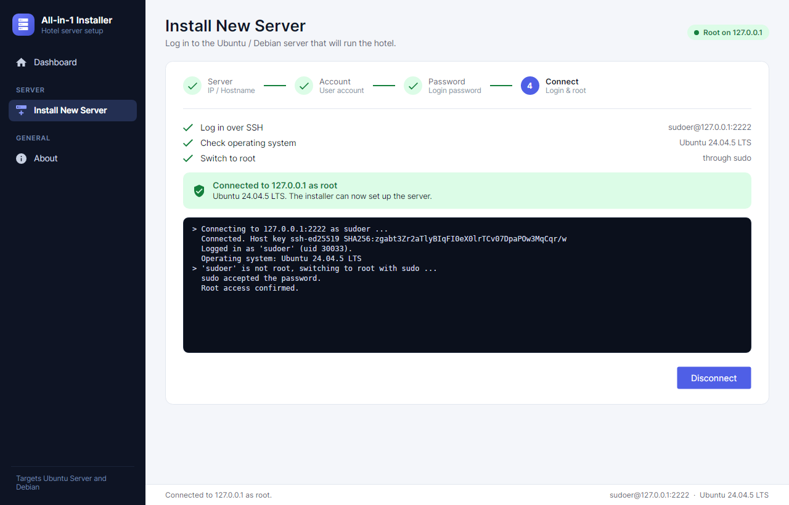

Later installation steps use `ServerConnection.RunAsRootAsync(...)`, which always runs as root:
directly when logged in as root, or through sudo.

**Step 2 – SSH key for root** (done)

After connecting, **Next: SSH key** puts a key in `/root/.ssh/authorized_keys`. Choose one:

- **Generate a new key pair**: Ed25519 (recommended) or RSA 4096, in the standard OpenSSH format
  (works with `ssh`, SSH.NET, and PuTTYgen via *Conversions → Import key*). You must set a
  **key password** (at least 8 characters, typed twice). The private key is encrypted with it exactly
  like `ssh-keygen -N` does (aes256-ctr, bcrypt KDF with 16 rounds). The password is never stored and
  is cleared from the form after each run. The keys are saved in the **configuration directory** on
  this computer *before* anything changes on the server: `id_ed25519` (OpenSSH), `id_ed25519.pub`, and
  `id_ed25519.ppk`, the same key for PuTTY tools (plink in HeidiSQL, Pageant, WinSCP), encrypted with the same
  password. It is PPK version 2 (aes256-cbc, HMAC-SHA-1), which every PuTTY since 0.52 loads; version 3 would need
  Argon2. A key made before the `.ppk` existed can be converted with PuTTYgen (*Conversions → Import key*, then
  *Save private key*).
- **Use my own public key**: paste it or load a `.pub` file. The OpenSSH one-line format and the
  PuTTYgen `---- BEGIN SSH2 PUBLIC KEY ----` format both work. A pasted private key is refused.
  A copy of the public key is kept in the configuration directory.

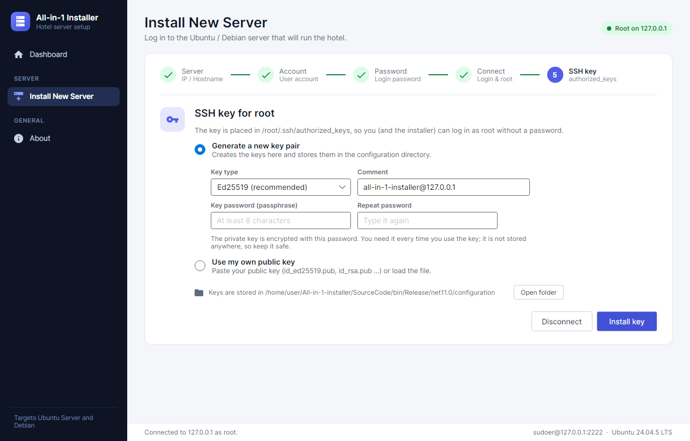

If the server already has keys, the installer lists them (comment, type, fingerprint, and whether your
key is already one of them) and asks:

- **Clean all keys and place this one**: only the new key remains.
- **Add my key to it**: keeps the existing keys, so the server has several (no duplicates).
- **Abort installation**: changes nothing on the server and disconnects. A key pair generated for
  this run is deleted again.

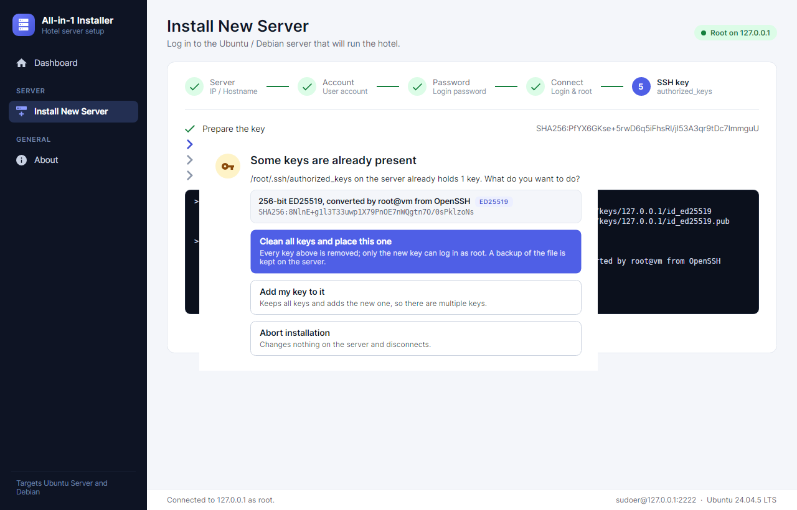

After an abort you choose **Abort** (leave the installation and go back to the dashboard) or
**Start over** (back to the first question).

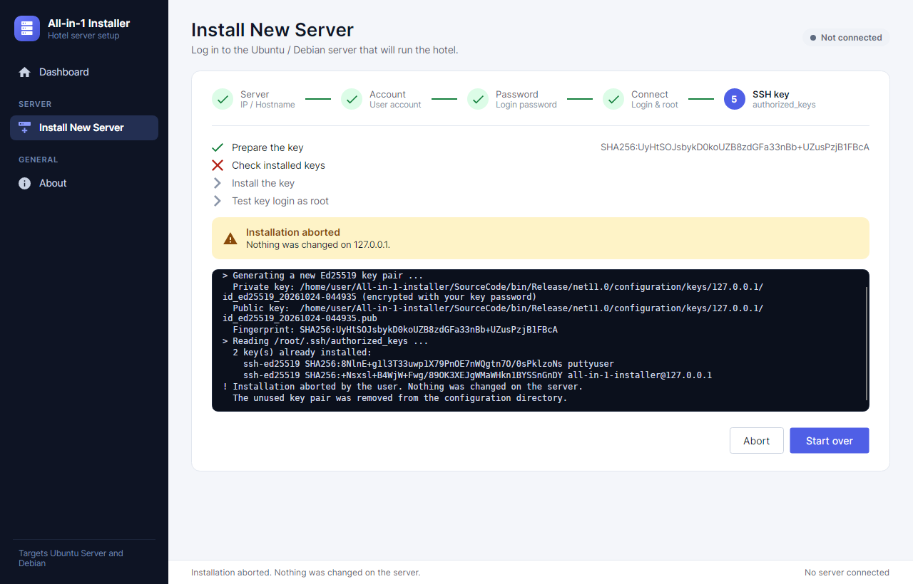

Before every change, the old file is backed up on the server as
`/root/.ssh/authorized_keys.bak-<date>-<random>`. The installer writes `/root/.ssh` with mode 700
and `authorized_keys` with mode 600, both owned by root, and checks that the key ended up in the file.
For a generated key it then opens a second SSH session **as root with the new key** to prove it works.
If that fails, it reports why (for example `PermitRootLogin no` in sshd). The second session only
trusts the host key seen during the first login.

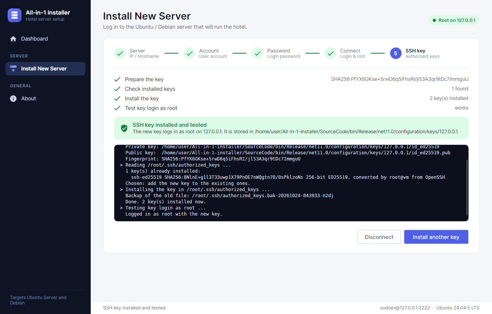

### The configuration directory

`configuration/` is created next to the installer (falling back to
`%LOCALAPPDATA%\All-in-1 Installer\configuration` or `~/.local/share/All-in-1 Installer/configuration`
when that folder is read-only). Keys are stored per server:

```
configuration/
  keys/
    <server>/
      id_ed25519              private key, encrypted with your key password (owner-only on Linux/macOS)
      id_ed25519.pub          public key
      provided_ed25519.pub    copy of a public key you provided
  database/
    <server>/
      mariadb.txt             MariaDB root, cms and emulator passwords (owner-only)
```

Existing files are never overwritten: a second key gets a timestamp, e.g. `id_ed25519_20261024-101500`.
**Keep this folder safe: it holds private keys and database passwords.** It is in `.gitignore`.

Log in later with the generated key (ssh asks for the key password):

```bash
ssh -i "configuration/keys/<server>/id_ed25519" root@<server>
```

**Step 3 – NGINX mainline** (done)

After the SSH key, **Next: NGINX** installs the web server:

1. **Check the server**: distribution, any installed NGINX, and what listens on port 80. If another
   program (Apache, ...) holds port 80, it stops here and nothing is changed.
2. **Add the nginx.org mainline repository**: `https://nginx.org/packages/mainline/<ubuntu|debian>`.
   The downloaded signing key must contain nginx.org's published key `573BFD6B3D8FBC641079A6ABABF5BD827BD9BF62`,
   and any key outside nginx.org's known set is refused. The repository is pinned (priority 900), so
   apt always takes NGINX from nginx.org.
3. **Install NGINX mainline** and check that the installed version really comes from nginx.org.
4. **Debian layout**: `nginx-common` itself can't be installed, because nginx.org's package declares
   `Conflicts/Replaces: nginx-common`, and the old repository that combined both (Ondřej Surý's) no
   longer exists. So the installer creates the same layout: `/etc/nginx/sites-available`,
   `sites-enabled` (included from `nginx.conf`), `snippets` and `proxy_params`. The nginx.org default site
   moves to `sites-available/default` and is enabled. On a server without IPv6 the `[::]:80` listen is
   disabled, because otherwise NGINX would not start.
5. **Start and test**: `nginx -t`, enable and start at boot, open 80/443 when `ufw` is active, and require
   HTTP 200 from `http://127.0.0.1/`.

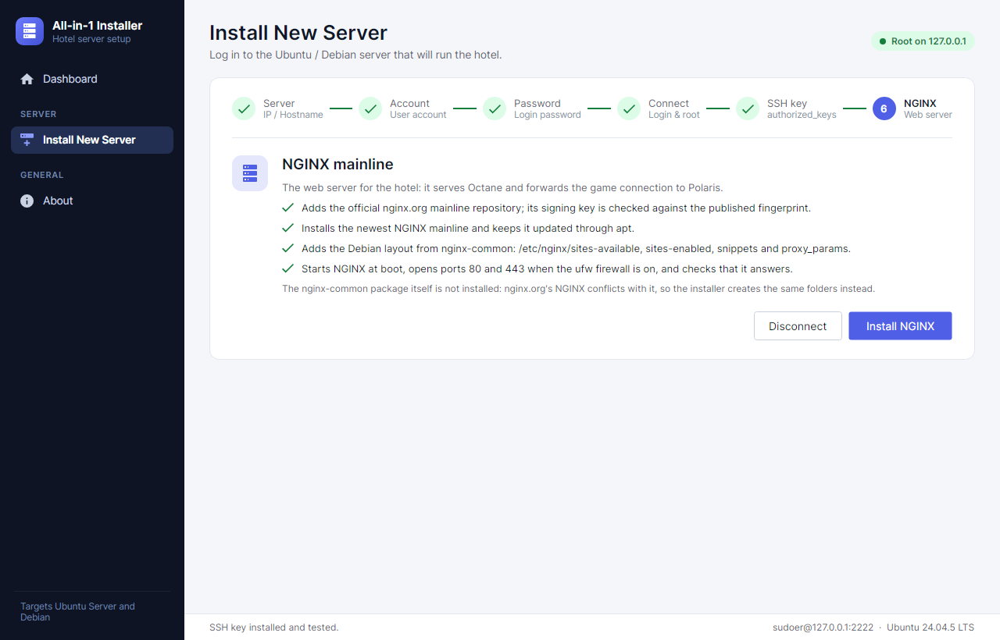

If Ubuntu/Debian's own NGINX is installed, you choose **Replace it with NGINX mainline** (`/etc/nginx` is
saved to `/root/nginx-backup-<date>.tar.gz`, the old packages are purged, and the configuration starts fresh)
or **Abort installation**. If nginx.org's NGINX is already there, the step upgrades it and keeps your
`nginx.conf` changes. Running the step again is safe.

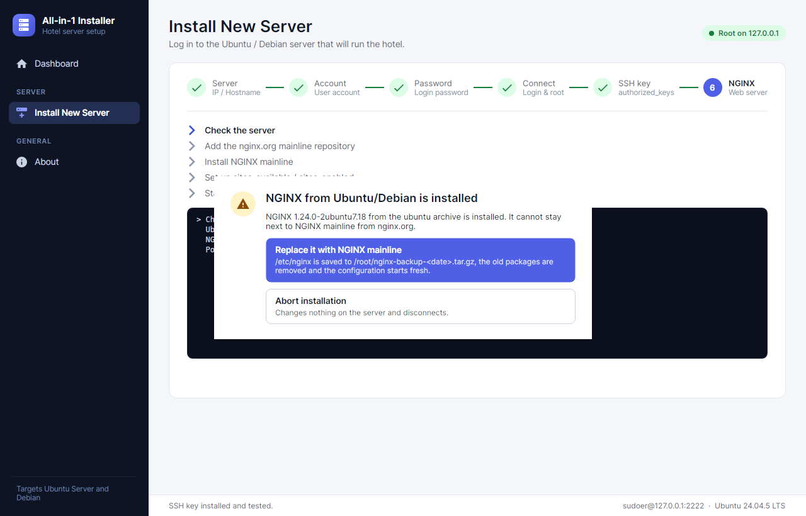

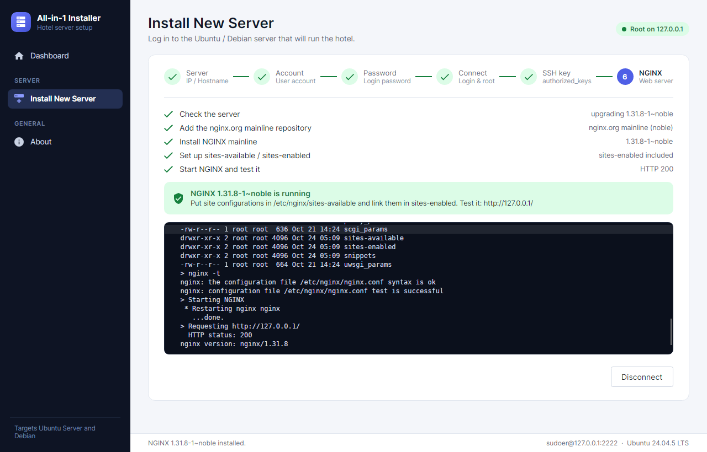

Long commands stream their output live into the log (`ServerConnection.RunAsRootStreamingAsync`).

Before every `apt-get update` the installer checks the **server clock** against the `Date` header of
`deb.debian.org`. A clock that is more than 2 minutes off is corrected and automatic time sync (NTP) is switched
on, because apt refuses repository files that seem to come from the future
(`Release file ... is not valid yet`).

**Step 4 – PHP 8.5 with PHP-FPM** (done)

After NGINX, **Next: PHP** installs:

```
php8.5-fpm php8.5 php8.5-common php8.5-mysql php8.5-xml php8.5-xmlrpc php8.5-curl php8.5-gd
php8.5-imagick php8.5-cli php8.5-mbstring php8.5-soap php8.5-zip php8.5-intl php8.5-bcmath unzip
```

PHP **8.5.12 or newer** is required because older releases have security problems. The installer refuses
to finish with an older version.

1. **Check the server**: installed PHP version, missing packages, other PHP versions (those are left alone).
2. **Add the repository** as in `packages.sury.org/php/README.txt`, which works for Debian (bookworm, trixie)
   and Ubuntu (jammy, noble, resolute). Before `dpkg -i`, the downloaded `debsuryorg-archive-keyring.deb`
   is unpacked and must hold Sury's key `15058500A0235D97F5D10063B188E2B695BD4743`. `php8.5*` is pinned to
   packages.sury.org, so an older distro 8.5 can never win.
3. **Install** the packages and require `PHP_VERSION` ≥ 8.5.12; `php` on the command line points to 8.5.
4. **Check** that all extensions load (`php8.5 -m`) and that `php-fpm8.5 -t` passes.
5. **Start PHP-FPM** at boot. When NGINX is installed: user `nginx` joins group `www-data` (owner of
   `/run/php/php8.5-fpm.sock`), `snippets/fastcgi-php.conf` is created (as in Debian's nginx-common), and a
   temporary site on `127.0.0.1:8085` must serve a PHP page through NGINX. The test site is removed afterwards.

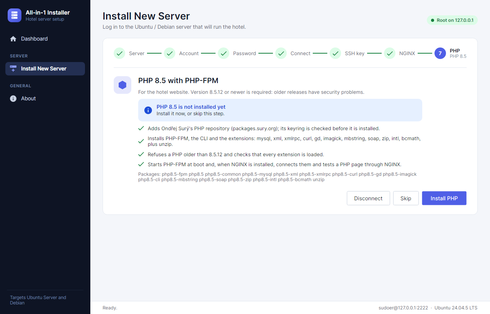

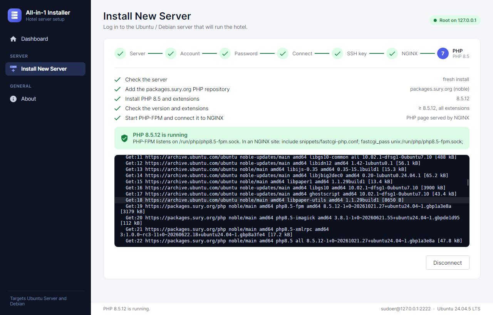

In an NGINX site:

```nginx
location ~ \.php$ {
    include snippets/fastcgi-php.conf;
    fastcgi_pass unix:/run/php/php8.5-fpm.sock;
}
```

**Step 5 – MariaDB 12.3** (done)

After PHP, **Next: MariaDB** installs the database:

1. **Check the server**: an installed MariaDB (Ubuntu/Debian's or another mariadb.org version) is upgraded
   after you agree, and **all databases are first saved to `/root/mariadb-backup-<date>.sql.gz`**. If MySQL
   is installed, the step stops: MariaDB can't be installed next to it.
2. **Add the repository** `https://dlm.mariadb.com/repo/mariadb-server/12.3/repo/<ubuntu|debian>` (Ubuntu
   22.04/24.04/26.04, Debian 11/12/13). The signing key from `mariadb.org/mariadb_release_signing_key.pgp`
   must be `177F4010FE56CA3336300305F1656F24C74CD1D8`; the repository is pinned.
3. **Install MariaDB 12.3** and check that the *running* server is 12.3. A server still running the replaced
   old program (when package scripts may not restart services) is shut down cleanly first. Then
   `mariadb-upgrade` runs.
4. **Secure it**, with the same answers as your `mariadb-secure-installation`: unix_socket switch **n**, change
   root password **n**, remove anonymous users **Y**, disallow remote root **n**, remove test database **Y**,
   reload privileges **Y**. Then `bind-address = 0.0.0.0` in `/etc/mysql/mariadb.conf.d/50-server.cnf` (a backup
   of the file is kept). Port 3306 is **never** opened in the firewall: connect through an SSH tunnel (see Harden).
   `root@localhost` keeps its socket login and also accepts the root password, because a tunnel arrives from
   127.0.0.1, which MariaDB counts as `localhost`.
5. **Create the users and database** with **generated passwords** (32 letters and digits):
   ```sql
   root@'%'  -- ALL PRIVILEGES ON *.* WITH GRANT OPTION
   cms@'%'   -- EXECUTE, SELECT, SHOW VIEW, ALTER, ALTER ROUTINE, CREATE, CREATE ROUTINE, CREATE TEMPORARY TABLES,
             -- CREATE VIEW, DELETE, DROP, EVENT, INDEX, INSERT, REFERENCES, TRIGGER, UPDATE, LOCK TABLES ON habbo.*
   CREATE SCHEMA habbo;
   ```
   `root@localhost` keeps its socket login (no password) for administering MariaDB on the server itself.
   The SQL goes to the server over stdin, so the passwords never appear in a command line (`ps`), and
   password hashes are masked in the log.
6. **Test the logins**: root with its password over the network address (that is `root@'%'`), root locally
   over the socket, and cms remotely, over 127.0.0.1 and over the socket, including creating a table in `habbo`.

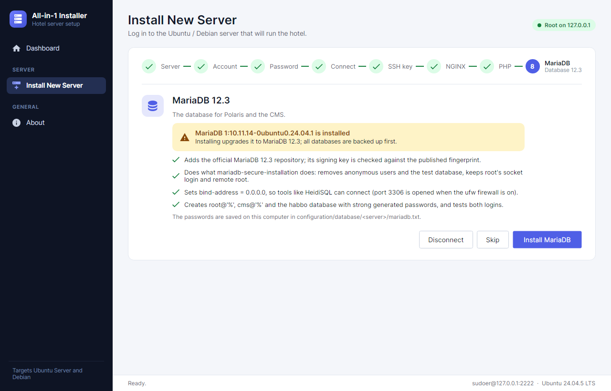

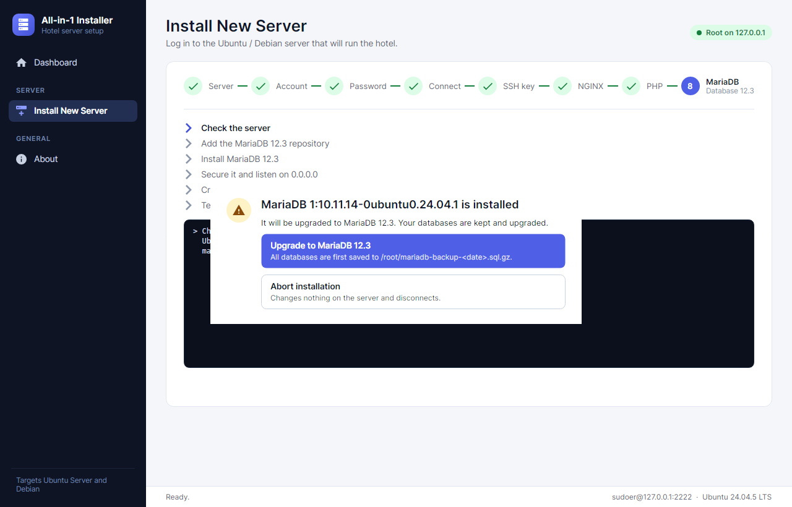

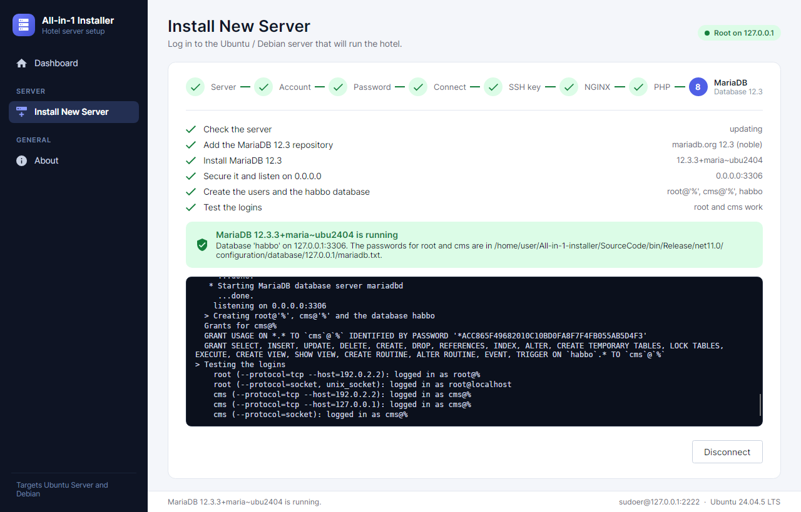

The passwords are saved **before** anything changes on the server, in
`configuration/database/<server>/mariadb.txt` (owner-only):

```
host=192.168.0.155
port=3306
database=habbo
root_user=root
root_password=...
cms_user=cms
cms_password=...
```

Running the step again reuses these passwords. If the users exist on the server but there is no saved file
(e.g. from another PC), new passwords are set and saved. The step says so before you install.

**Step 6 – Node.js 26, Composer and Yarn** (done)

After MariaDB, **Next: Node.js** installs the build tools, following your commands:

1. **Check the server**: Composer needs PHP, so without PHP the step stops before changing anything.
2. **Add NodeSource** `https://deb.nodesource.com/node_26.x nodistro main` with the key in
   `/etc/apt/keyrings/nodesource.gpg`. The key must be `6F71F525282841EEDAF851B42F59B5F99B1BE0B4` (NSolid), and
   `nodejs` is pinned to NodeSource.
3. **Install Node.js 26** (`apt-get install nodejs`, which includes npm) and check the major version.
4. **Install Composer**: the latest stable `composer.phar` from `getcomposer.org/download`, checked against its
   published SHA-256, to `/usr/bin/composer`. Not `composer-setup.php`: it downloads the phar itself without a
   timeout and can hang forever on a broken IPv6 route. All installer downloads use curl with timeouts and retry
   over IPv4.
5. **Install Yarn**: `npm install -g corepack`, `corepack enable`, and Yarn stable as the default outside
   projects. Each project uses the Yarn in its `package.json` (Octane: `yarn@4.18.0`).
6. **Check the versions**: `node`, `npm`, `yarn` and `composer --version`.

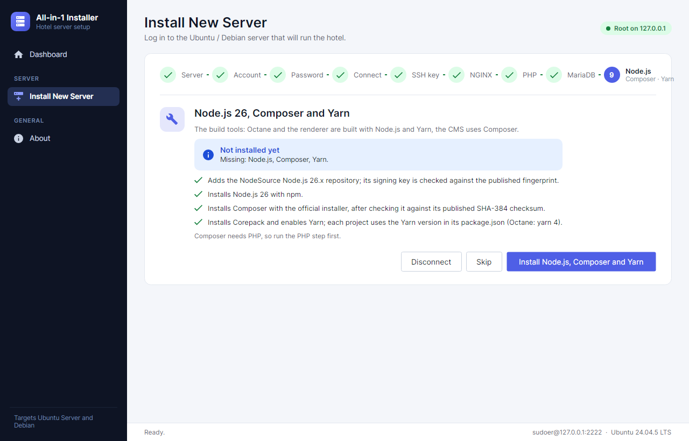

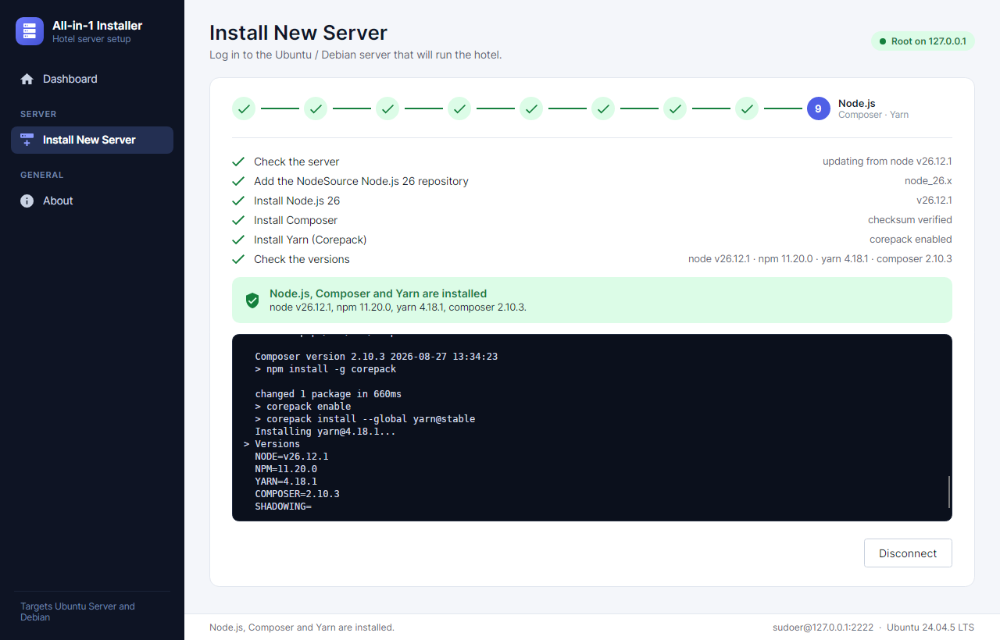

The step uses and tests the tools it installs in `/usr/bin`, also when an older `node`, `npm` or `composer`
(e.g. a hand-installed one in `/usr/local/bin`) comes first in root's `PATH`. Those older copies are reported
as a warning with their paths, so typing `node` really runs Node.js 26 after you remove them; the installer
does not delete them itself.

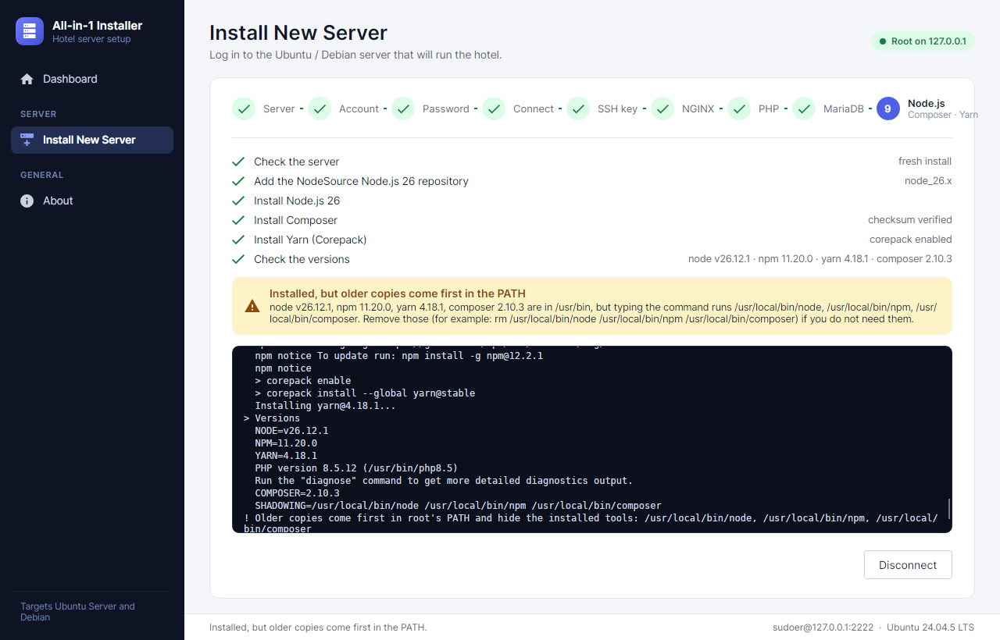

**Steps 7–9 – Clone Polaris, Octane and Octane-Renderer** (done)

| Step | Repository | Folder on the server |
|------|------------|----------------------|
| Polaris | https://github.com/duckietm/Polaris-Emulator | `/var/www/emulator` |
| Octane | https://github.com/duckietm/Octane | `/var/www/Octane` |
| Renderer | https://github.com/duckietm/Octane-Renderer | `/var/www/Octane-Renderer` |

Each step clones the full history (so `git pull` can update it later) and installs git first when needed. The
log keeps only the readable progress lines.

- **Folder missing or empty**: `git clone`.
- **Folder already holds that repository** (`origin` matches, also as `git@github.com:...`): the step shows the
  branch, commit, locally changed files and new commits, and offers **Skip** or **Update (git pull)**. The update
  is `git pull --ff-only`, and it is refused when files tracked by git were changed, so local work is never lost.
- **Folder holds something else** (other files, or a clone of another repository): **Move it aside and clone**
  renames it to `<folder>.bak-<date>` (nothing is deleted), or **Abort installation**.

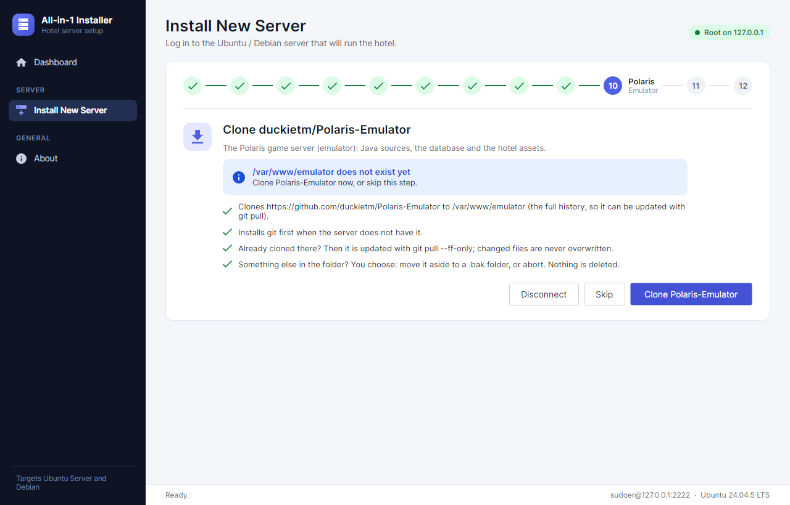

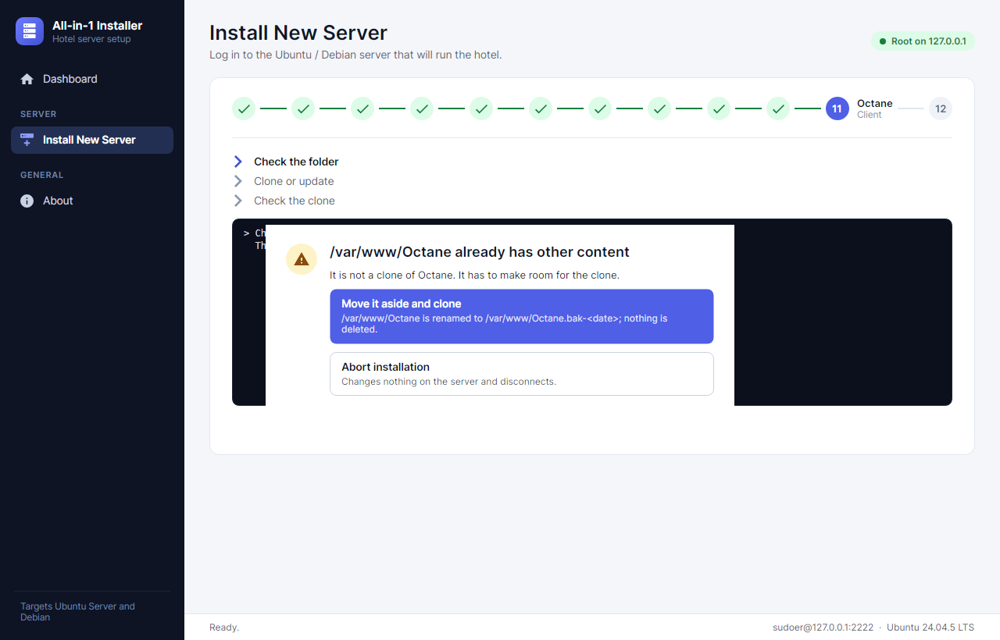

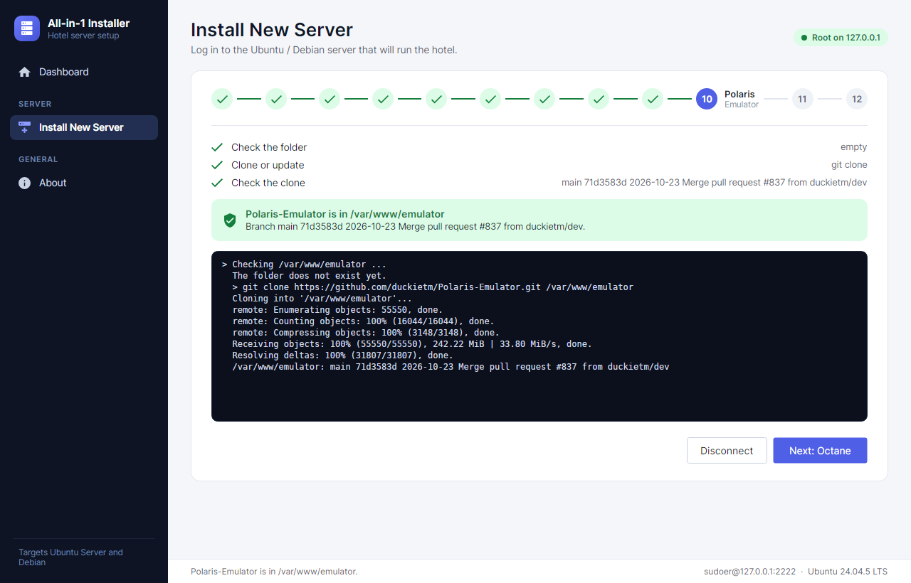

**Step 10 – Build and run the Polaris emulator** (done)

After the clones, **Next: Emulator** builds `/var/www/emulator/Emulator` and runs it as a service. On the intro
page you choose:

- **Timezone** for `config.ini` (`serverTimezone`): a dropdown with every IANA timezone the server knows
  (`timedatectl list-timezones`; this computer's list when the server has none), each with its current UTC
  offset. Type the first letters to jump. Defaults to **Europe/Amsterdam**, or the timezone already in `config.ini`.
- **Memory** (`-Xmx`): 1–16 GB, defaulting to 4 GB (less on small servers; the server's RAM is shown).
- **Websocket whitelist** (`ws.whitelist`): hosts the client may connect from; add your hotel's domain
  (`hotel.com,*.hotel.com`). Polaris's default is `*` (any site); the installer replaces it.

What it does:

1. **JDK 25**: `openjdk-25-jdk-headless` (Ubuntu 22.04/24.04/26.04, Debian 13), or **Eclipse Temurin 25** from
   Adoptium (key `3B04D753C9050D9A5D343F39843C48A565F8F04B` checked) where the distribution has no OpenJDK 25
   (Debian 11/12). `pom.xml` requires JDK 25–26, so the scripts name that JDK explicitly; the server's default
   `java` is not changed.
2. **Account**: system user `emulator` (no login shell, home `/var/lib/emulator`), member of `www-data`. It owns
   `/var/www/emulator` and the log folder `/var/log/emu` (`2750 emulator:www-data`, so logs are group-readable).
3. **Build** with `/var/www/emulator/Emulator/build.sh`, run as `emulator`:
   ```sh
   ./build.sh               # mvn -B -ntp clean package -DskipTests -f pom.xml   (about 1 minute)
   ./build.sh --with-tests  # also the 4000+ unit tests                          (about 4 minutes)
   ```
   `pom.xml` requires Maven 3.9.11+, which is newer than apt's `maven` (3.8.7 on Ubuntu 24.04). The installer
   downloads the version the Maven Wrapper asks for (`.mvn/wrapper/maven-wrapper.properties`, now 3.10.0) to
   `/opt/apache-maven-<version>` itself: from Maven Central, else `dlcdn.apache.org` / `archive.apache.org`, with
   timeouts and an IPv4 retry, and checks the sha256 from that file. (`mvnw` downloads silently and without a
   timeout, which could hang the step forever.) `build.sh` falls back to `./mvnw` when that folder is missing.
   While Maven runs, the log shows a progress line every 30 seconds; the build is stopped after 30 minutes.
   The first build downloads about 150 MB of libraries to `/var/lib/emulator/.m2`. The JAR is now called
   `Polaris-<version>-jar-with-dependencies.jar`.
4. **Database account, config.ini, service**:
   - MariaDB account `emulator@localhost` with `ALL PRIVILEGES ON habbo.*` and a generated password, saved as
     `emulator_user` / `emulator_password` in `configuration/database/<server>/mariadb.txt` (sent over stdin).
   - `Emulator/config.ini` (`640 emulator:www-data`) from the repository's `config.ini.example`: `db.*` for the
     emulator account, `db.params=?characterEncoding=utf8&useSSL=false&serverTimezone=<your timezone>`, and
     generated secrets for `nitro.secure.master_key` and `login.remember.jwt.secret`. On a re-run only the
     database settings change; the rest of your `config.ini` is kept (with a `.bak-<date>` copy).
   - Start script `Emulator/emulator`: runs the newest JAR in `target/` with JDK 25 and your memory, logs to
     `/var/log/emu/emulator.log`, keeps the previous log as `emulator.log.<time>` (30 days).
   - `/etc/systemd/system/emulator.service`: `User=emulator`, `SupplementaryGroups=www-data`, after and requiring
     `mariadb.service`, `Restart=on-failure`, enabled at boot. `WorkingDirectory` is `Emulator/` (not `target/`),
     so `config.ini` survives `mvn clean`.
5. **Start**: the first start creates all database tables (Polaris migrations); then `console.mode = 0` and
   `ws.whitelist` (and the old `websockets.whitelist`) are set in `emulator_settings`, and it restarts when they
   changed. It waits for `Polaris has successfully loaded.` and checks port 3000 (opened in ufw when active).

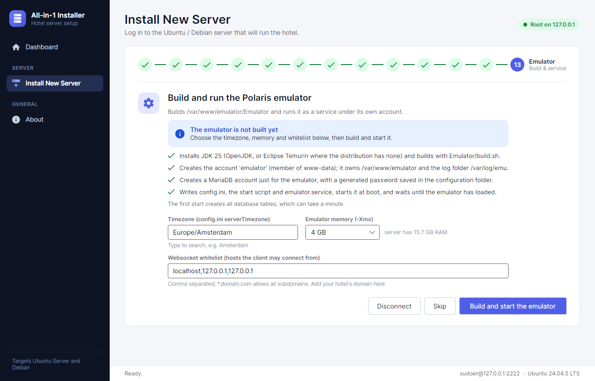

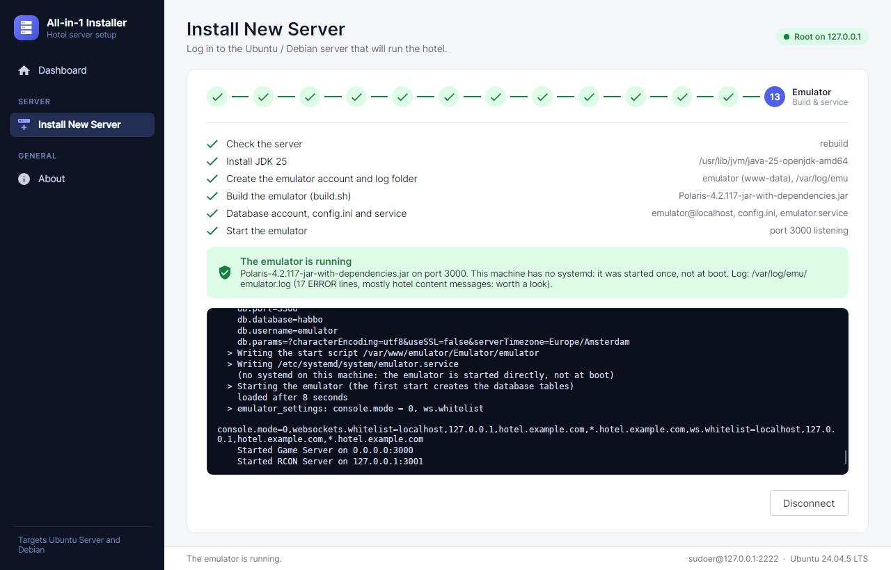

```sh
systemctl status emulator          # running?
systemctl restart emulator         # after changing config.ini
tail -f /var/log/emu/emulator.log  # follow the log
cd /var/www/emulator/Emulator && sudo -u emulator ./build.sh && systemctl restart emulator   # rebuild
```

**Step 11 – Web access: Docker and Traefik** (done)

The step asks three questions:

1. **Do you use Cloudflare?** yes / no
2. **http or https?**
3. **The hotel's address**: a domain name (`example.com`) or an IP address. Typing `https://example.com/`
   also works: the scheme is taken from it.

https and Cloudflare need a domain name (Let's Encrypt gives no certificates for IP addresses).

What it sets up, for example for `https://example.com`:

```
https://example.com/...      Traefik (80/443) -> NGINX      http://127.0.0.1:85
https://example.com/ws       Traefik          -> Polaris    http://127.0.0.1:2096  (game websocket)
https://example.com/api/...  Traefik          -> Polaris    http://127.0.0.1:2096  (login, CMS API ...)
```

1. **Docker Engine** as on [docs.docker.com/engine/install/ubuntu](https://docs.docker.com/engine/install/ubuntu/)
   (and `/debian`): conflicting packages (`docker.io`, `podman-docker`, `containerd`, `runc` ...) are removed after
   you agree, the key `9DC858229FC7DD38854AE2D88D81803C0EBFCD88` is checked, `docker.sources` is added, and
   `docker-ce docker-ce-cli containerd.io docker-buildx-plugin docker-compose-plugin` are installed.
2. **NGINX** gets the site `/etc/nginx/sites-available/hotel` (`HotelSite.cs`; the Octane step writes the same
   file with its own root), modelled on a production Octane site:
   - `listen 127.0.0.1:85` only (so it is reachable through Traefik only), `server_name` with and without `www.`,
     `real_ip` from Traefik, `server_tokens off`, `autoindex off`, security headers (`X-Content-Type-Options`,
     `Referrer-Policy`, `Permissions-Policy`, and HSTS with https), logs in `/var/log/nginx/hotel/`;
   - `/configuration/` and `/.vite/manifest.json` never cached, hashed build files in `assets/` cached for a year;
   - `/gamedata/` from `/var/www/gamedata` (camera photos in `/gamedata/camera/`) and `/custom/` from
     `/var/www/gamedata/custom`, with CORS (and `OPTIONS` preflight) only for the hotel's own origin
     (`map $http_origin`), and images / `.nitro` / `.hab` cached for 30 days. `nginx` is added to the `www-data`
     group, so it can read the photos the emulator writes (mode 640, group `www-data`).

   The default site is disabled; another site that still listens on 80/443 stops the step with its file name.
3. **Traefik v3** in Docker (`/opt/traefik`): `compose.yaml` (host network, `restart: unless-stopped`),
   `traefik.yml`, `dynamic/hotel.yml` (the routes above) and `hotel.env` (your answers). With https, http
   redirects to https and the Let's Encrypt certificate (HTTP challenge) is renewed automatically. With
   Cloudflare, `X-Forwarded-For` is only trusted from Cloudflare's published IP ranges; without it, Traefik
   writes the header itself, so it cannot be faked. Ports 80 and 443 are opened in ufw when it is active.
4. **Polaris**: the address is added to `ws.whitelist` (websocket origins and CORS for `/api`), and
   `ws.ip.header = X-Forwarded-For`, so bans and rate limits see the visitor's IP. The emulator restarts when
   that changed.
5. **Test** on the server through Traefik: the site, `/api/health` and a websocket upgrade on `/ws` (101), and
   with https it waits up to 2 minutes for the certificate. Without a certificate the step ends with a warning
   that shows Let's Encrypt's error (usually: the domain does not point to this server yet, or port 80 is closed).

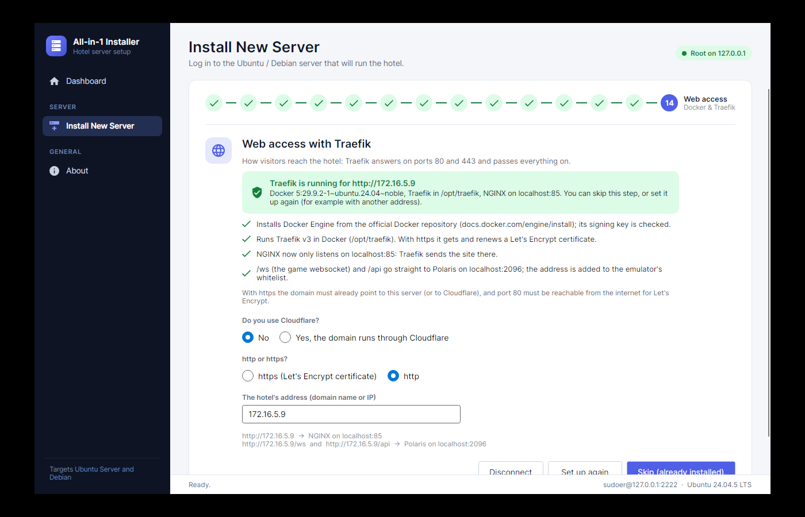

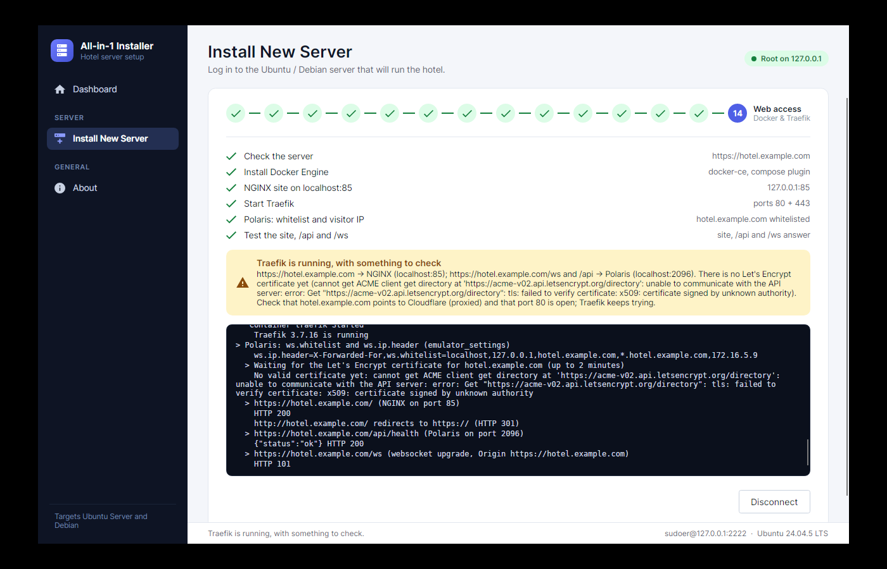

With Cloudflare: keep the DNS record **proxied** (orange cloud) and set SSL/TLS to **Full (strict)** for https.

```sh
cd /opt/traefik && docker compose logs -f traefik        # Traefik log (certificates, routing errors)
cd /opt/traefik && docker compose pull && docker compose up -d   # update Traefik
```

**Step 12 – Octane client** (done)

Uses the address from the web access step; nothing to fill in. For `https://example.com`:

1. `yarn install` in `/var/www/Octane-Renderer`, then in `/var/www/Octane` (Node.js 26 and Yarn 4 from `/usr/bin`).
2. In `/var/www/Octane/public/configuration`, `client-mode`, `hotlooks`, `infostand_backgrounds`, `news`,
   `renderer-config` and `ui-config` `.json` are created from the `.example` files (existing files are kept), and
   the URL keys are set (an existing file that changes is saved as `.bak-<time>` first):

   | File | Keys |
   |---|---|
   | `renderer-config.json` | `socket.url` = `wss://example.com/ws` (`ws://` with http), `api.url` = `https://example.com`, `asset.url` = `https://example.com/gamedata`, `image.library.url` = `…/gamedata/c_images/`, `hof.furni.url`, `furni.asset.icon.url` = `…/gamedata/icons/…`, `badge.asset.group.url` = `…/gamedata/c_images/groupbadge/badge/%badgedata%`, `badge.asset.grouparts.url` = `…/gamedata/c_images/groupbadge/badgeparts/badgepart_%part%.png`, `group.badge.url` = `%imagerdata%` |
   | `ui-config.json` | `camera.url` = `https://example.com/gamedata/camera`, `thumbnails.url` = `…/gamedata/camera/thumb/%thumbnail%.png`, `camera.render.mode` = `upload` |
   | `client-mode.json` | `apiBaseUrl` = `https://example.com`, `plainConfigBaseUrl` = `…/configuration/`, `plainGamedataBaseUrl` = `…/gamedata/` |

   A new file also gets `timezone.settings` from the emulator's
   timezone, and in `client-mode.json` obfuscation, secure assets and secure API off.
3. **`/var/www/gamedata`**: every folder those URLs point to is created (`config`, `furniture`, `clothes`,
   `effect`, `pets`, `room`, `icons`, `c_images/album1584`, `c_images/catalogue`, … 26 in all), owned by
   `www-data` with the group sticky (`2775`). **The assets themselves are not copied**: put them there with the
   All-in-1 download tool. The emulator writes into it as well (custom badges into `c_images/album1584`,
   `users_custom_badge_settings.badge_path`; furni editor changes into `config/*.json`), so
   `/usr/local/sbin/gamedata-permissions` gives the `www-data` group read/write access with **default ACLs**: files
   copied in later as root or another user stay writable for the emulator and readable for NGINX. Run it again if
   an upload tool reset the permissions. `news/news.json` (the login screen's news, `login.news.url`) gets a "Welcome to <address>!"
   message when it does not exist yet; your own news is never overwritten.
4. `yarn build` (and `/var/www/Octane/build.sh`, which runs both `yarn install`s and the build again: use it after
   changing the configuration or after a `git pull`).
5. The hotel site is written again with `root /var/www/Octane/dist` (also when it came from an older version of
   the web access step), and the step checks through Traefik that
   `index.html` and `configuration/renderer-config.json` are served.

6. **Camera and badge imager**: in the emulator's `emulator_settings` (the emulator is stopped while they are written, then started
   again; nothing happens when they are already set):

   | Key | Value |
   |---|---|
   | `camera.url` | `https://example.com/gamedata/camera/` |
   | `imager.location.output.camera` | `/var/www/gamedata/camera` |
   | `imager.location.output.thumbnail` | `/var/www/gamedata/camera/thumb/` |
   | `camera.render.mode` | `auto` |
   | `imager.location.output.badges` | `/var/www/gamedata/c_images/album1584/` |
   | `imager.location.badgeparts` | `/var/www/gamedata/c_images/groupbadge/badgeparts/` |

   The folders (`camera`, `camera/thumb`, `c_images/album1584`, `c_images/groupbadge/badge` and `badgeparts`) are
   created for the `www-data` group.

```sh
nano /var/www/Octane/public/configuration/ui-config.json   # e.g. hotel.name
/var/www/Octane/build.sh                                   # rebuild dist/ with it
```

**Step 13 – Harden the server** (done)

Nothing to fill in.

1. **Polaris** (the emulator is stopped while they are written, then started again):
   `ws.whitelist` = only the hotel's address (`example.com`; Polaris drops `www.` itself), the old
   `websockets.whitelist` the same, and `ws.ip.header` = `X-Forwarded-For`.
   That header is right **with Cloudflare too**: Polaris only reads it from a trusted proxy (Traefik, on
   127.0.0.1). Traefik keeps the `X-Forwarded-For` from Cloudflare's ranges only (visitor first, Polaris takes the
   first entry) and replaces it for everyone else, so it cannot be faked; `CF-Connecting-IP` is not needed.
2. **MariaDB over an SSH tunnel**: 3306 stays closed; HeidiSQL and the like use your SSH key. A tunnel arrives
   from 127.0.0.1, which MariaDB counts as `root@localhost` (socket login only), so that account also gets the
   saved root password (`IDENTIFIED VIA unix_socket OR mysql_native_password`). In HeidiSQL: network type
   **MariaDB or MySQL (SSH tunnel)**; on the *SSH tunnel* tab `plink.exe`, the server, port, user and the **`.ppk`**
   (plink only reads PuTTY keys; it cannot ask for the key password inside HeidiSQL, so load the `.ppk` in
   **Pageant** first, and log in once with PuTTY to accept the host key), SSH timeout about 10 seconds; on the
   *Settings* tab host `127.0.0.1`, user `root` or `cms` with the password from
   `configuration/database/<server>/mariadb.txt`.
3. **TCP stack** in `/etc/sysctl.conf` (a `.bak-<time>` copy first; existing lines for these keys are replaced) and
   applied right away: `net.ipv4.tcp_syncookies=1`, `net.ipv4.tcp_max_syn_backlog=2048`,
   `net.ipv4.tcp_synack_retries=3`.
4. **Firewall (ufw)**, from a clean rule set (ufw keeps the old rules as `/etc/ufw/*.rules.<date>`):
   ```
   ufw default deny incoming
   ufw default allow outgoing
   ufw limit <ssh port>/tcp comment 'Rate limit for openssh server'   # every port sshd uses + the one you are on
   ufw allow 80/tcp, 443/tcp                                          # or, with Cloudflare, only from its IP ranges
   ufw --force enable
   ```
   MariaDB (3306) and the emulator's ports (3000, 2096) stay closed: the game runs through Traefik on `/ws`. Traefik runs in Docker
   with the host network, so Docker publishes no ports past ufw. Without IPv6 only Cloudflare's IPv4 ranges are
   used. `/etc/ufw/all-in-1-hardened` marks the firewall as managed: the NGINX, MariaDB, Emulator and Web access
   steps then no longer open ports themselves.
5. **Log in again**: a new SSH login through the firewall proves you are not locked out (the current session stays
   open; if it fails, the step says so and `ufw disable` undoes it).

**Completed – upload the assets** (done)

After the last step (done or skipped) the wizard shows **Successfully completed** (or *Completed, with steps to look
at* when a step was skipped or failed), with what every step did, and then:

1. Download all assets with the **All-in-1 downloader**.
2. Upload them with **WinSCP**: SFTP, the server and SSH port, user `root`, the `.ppk` key from the configuration
   folder (*Advanced… → SSH → Authentication*), into `/var/www/gamedata/`.
3. Where everything goes:

   | Folder in `/var/www/gamedata` | Contents |
   |---|---|
   | `config/` | FurnitureData.json, ProductData.json, FigureData.json, FigureMap.json, EffectMap.json, HabboAvatarActions.json, ExternalTexts.json, UITexts.jsonc |
   | `furniture/` | furniture bundles (&lt;name&gt;.hab) |
   | `clothes/` | clothing bundles (&lt;name&gt;.hab) |
   | `effect/` | avatar effect bundles (&lt;name&gt;.hab) |
   | `pets/` | pet bundles (&lt;name&gt;.hab) |
   | `bundled/generic/` | generic bundles (&lt;name&gt;.hab) |
   | `room/` | room bundles (room/&lt;name&gt;/&lt;name&gt;.json) |
   | `icons/` | furniture icons (&lt;name&gt;_icon.png) |
   | `images/` | loading_icon.png, clear_icon.png, big_arrow.png, reception/ (hotel view), wallet/ (currency icons) |
   | `sounds/` | sounds (&lt;sample&gt;.mp3, sound_machine_sample_&lt;n&gt;.mp3) |
   | `c_images/album1584/` | badges (&lt;code&gt;.gif); custom badges are added here by the emulator |
   | `c_images/catalogue/` | catalogue headers and icons |
   | `c_images/reception/` | login screen images |
   | `c_images/notifications/, Quests/, fx_icons/, habboway/, web_promo_small/, album1358/` | notification, achievement, effect and promo images |
   | `c_images/groupbadge/badgeparts/` | group badge parts (badgepart_&lt;part&gt;.png) |
   | `habbopages/` | the hotel's help/info pages |
   | `custom/` | your own extra files (served as /custom/) |
   | `news/news.json` | login screen news (the welcome message is already there) |
   | `camera/, c_images/groupbadge/badge/` | filled by the emulator: do not upload |

4. After uploading: `sudo /usr/local/sbin/gamedata-permissions` (write access for the emulator), open the hotel
   (**Open &lt;url&gt;** button), register the first account, log out and make it administrator:
   ``UPDATE users SET `rank` = 7 WHERE username = 'YourName';`` (HeidiSQL over the SSH tunnel).

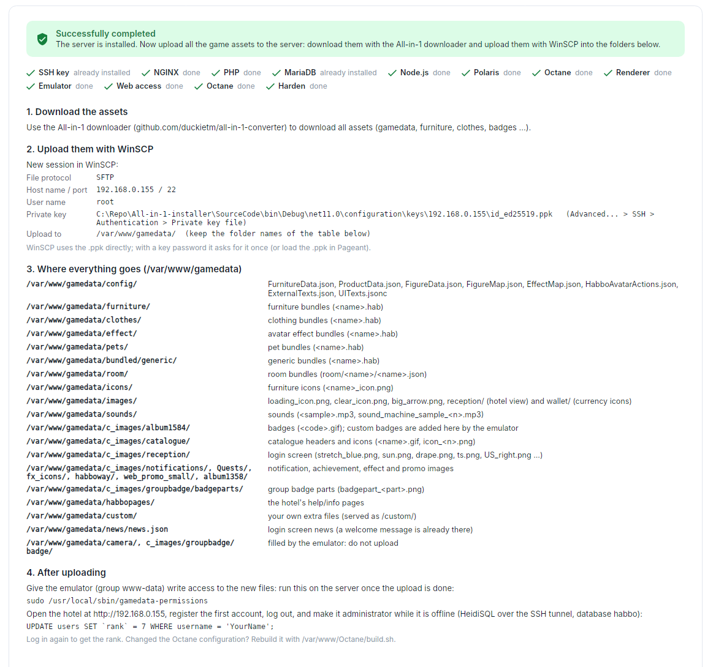

### Running the installer again

Every install step first checks the server and shows what it found:

| Step | Counts as already installed when | Buttons |
|------|----------------------------------|---------|
| SSH key | a public key saved in `configuration/keys/<server>/` is in `/root/.ssh/authorized_keys` | **Skip (already installed)** · Install another key |
| NGINX | NGINX from nginx.org is installed and `nginx.conf` includes `sites-enabled` | **Skip (already installed)** · Reinstall / upgrade |
| PHP | all packages installed, PHP ≥ 8.5.12 and PHP-FPM running | **Skip (already installed)** · Reinstall / upgrade |
| MariaDB | 12.3 from mariadb.org running on 0.0.0.0, users and `habbo` exist, and the saved cms password works | **Skip (already installed)** · Reinstall / upgrade |
| Node.js | Node.js 26 from NodeSource, Yarn and Composer in `/usr/bin` | **Skip (already installed)** · Reinstall / upgrade |
| Polaris / Octane / Renderer | the folder is a clone of that repository | **Skip (already installed)** · Update (git pull) |
| Emulator | JDK 25, the `emulator` account, a built JAR, `config.ini`, and the emulator running | **Skip (already installed)** · Rebuild and restart |
| Web access | Docker from download.docker.com running, the Traefik container running, the hotel site on 127.0.0.1:85 | **Skip (already installed)** · Set up again |
| Harden | ufw active with deny incoming and no 3306 rule, the TCP settings in `/etc/sysctl.conf`, `ws.whitelist` = the hotel's address and `ws.ip.header` = `X-Forwarded-For` | **Skip (already installed)** · Apply again |
| Octane | `dist/` built, the site's root is `dist/`, `/var/www/gamedata` exists, `socket.url` matches the web access address and the camera URLs are set (ui-config and emulator) | **Skip (already installed)** · Configure and rebuild |

When a step is not done yet, the install button is the highlighted one and **Skip** is next to it
(for example, to keep using the password instead of a key). Skipping changes nothing on the server.
Skipping a step moves on to the next one, and a failed step can be skipped too.

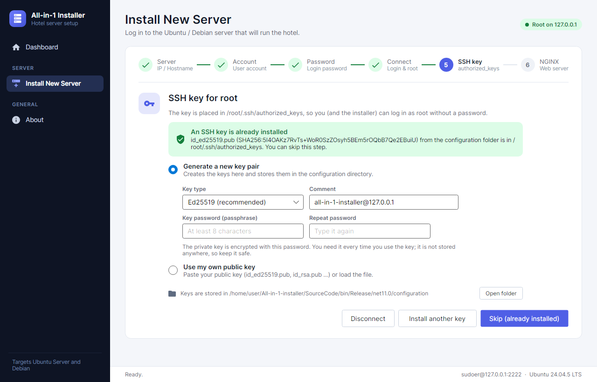

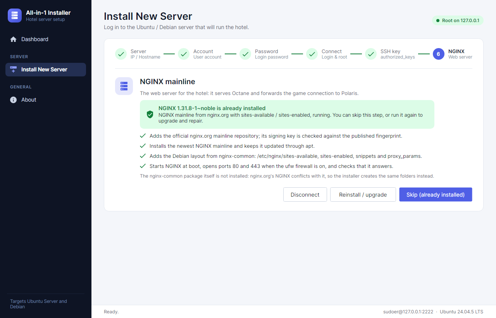

**Next steps:** none planned; every default step is in place. A new step is a
class derived from `InstallStep`, added to the `_installSteps` list in `NewServerWizard`.

## Building

Requires the .NET 11 SDK (see [Requirements](#requirements)).

```bash
cd SourceCode
dotnet run -c Release
```

Single-file builds, self-contained (.NET included, nothing to install on the computer that runs them):

```bash
./publish-linux.sh      # publish/linux-x64/All-in-1 Installer
publish-win.bat         # publish\win-x64\All-in-1 Installer.exe
```

The installer runs on your own Windows or Linux desktop and connects to the server, so the
server itself needs no GUI.

## Project layout

```
SourceCode/
  Program.cs                              Avalonia entry point
  App/Gui/AvaloniaApp.cs                  Fluent theme + Professional theme
  App/Professional/ProfessionalTheme.cs   Colours, button styles and icons (shared with the converter)
  App/Professional/Views/InstallerWindow.cs   Sidebar, header, dashboard
  App/Professional/Views/NewServerWizard.cs   "Install New Server" steps + connect page
  App/Professional/Views/SshKeyStep.cs    SSH key page (generate / own key, install, test)
  App/Professional/Views/ExistingKeysDialog.cs  "Some keys are already present" dialog
  App/Professional/Views/InstallStep.cs   Base class of the install steps (intro, detection, run panel)
  App/Professional/Views/NginxStep.cs     NGINX page
  App/Professional/Views/PhpStep.cs       PHP page
  App/Professional/Views/MariaDbStep.cs   MariaDB page
  App/Professional/Views/DevToolsStep.cs  Node.js / Composer / Yarn page
  App/Professional/Views/CloneStep.cs     Clone one repository (used for Polaris, Octane, Renderer)
  App/Professional/Views/EmulatorStep.cs  Emulator page (timezone, memory, whitelist)
  App/Professional/Views/WebAccessStep.cs Web access page (Cloudflare, http/https, address)
  App/Professional/Views/OctaneStep.cs    Octane page
  App/Professional/Views/HardenStep.cs    Harden page
  App/Professional/Views/FinishedView.cs  Completed page: summary, WinSCP and where the assets go
  App/Professional/Views/RunPanel.cs      Progress, check list, result and live log of an install step
  App/Professional/Views/ChoiceDialog.cs  Question with described answers
  App/Professional/Views/ProgressControls.cs    Check list and result banner
  App/Professional/Views/LogView.cs       Console output panel
  Configuration/ClientConfiguration.cs    The configuration/ directory on the client
  Configuration/DatabaseCredentials.cs    Generated MariaDB passwords and their file format
  Remote/ServerConnection.cs              SSH login, OS check, sudo -> root, RunAsRootAsync
  Remote/SshKeys.cs                       Key generation (encrypted OpenSSH format) and public key parsing
  Remote/BcryptPbkdf.cs                   bcrypt_pbkdf: turns the key password into the encryption key
  Remote/RootAuthorizedKeys.cs            Read / back up / write /root/.ssh/authorized_keys, test key login
  Remote/NginxInstaller.cs                NGINX mainline from nginx.org + Debian layout
  Remote/PhpInstaller.cs                  PHP 8.5 (≥ 8.5.12) from packages.sury.org, PHP-FPM + NGINX
  Remote/MariaDbInstaller.cs              MariaDB 12.3, secure-installation, bind-address, users, login tests
  Remote/DevToolsInstaller.cs             Node.js 26 (NodeSource), Composer (checksum), Yarn (Corepack)
  Remote/GitCloneInstaller.cs             Inspect / clone / update / move aside a git clone on the server
  Remote/EmulatorInstaller.cs             JDK 25, emulator account, build.sh, DB account, config.ini, service, start
  Remote/WebAccessInstaller.cs            Docker Engine, NGINX on 127.0.0.1:85, Traefik (/opt/traefik), Polaris whitelist, tests
  Remote/OctaneInstaller.cs               yarn install, Octane configuration + gamedata folders, yarn build, serve dist/
  Remote/HardenInstaller.cs               ufw firewall, Polaris ws.whitelist / ws.ip.header, sysctl SYN flood settings
  Remote/RemoteScript.cs                  Runs an install script as root with live output
```